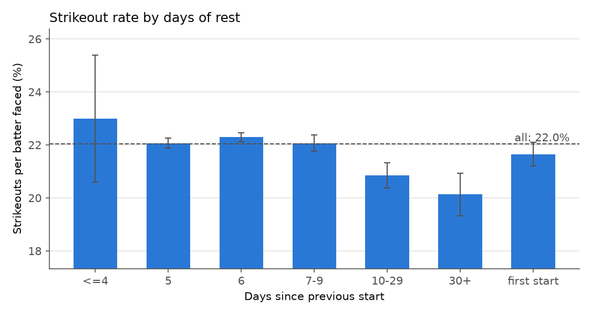
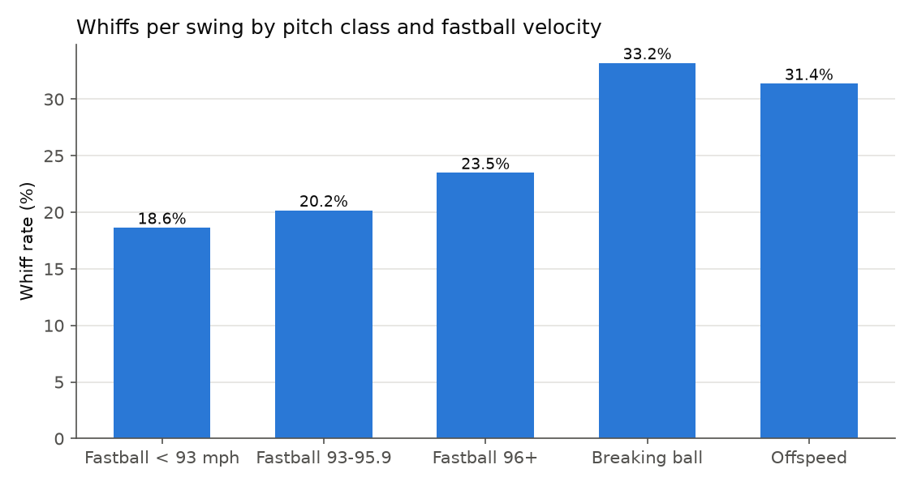
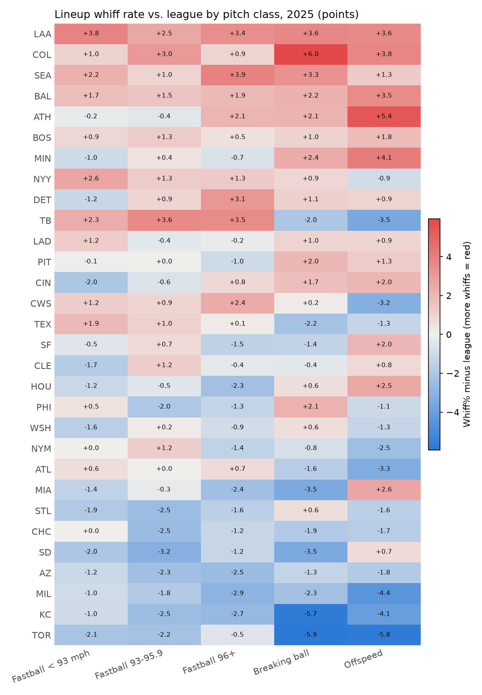
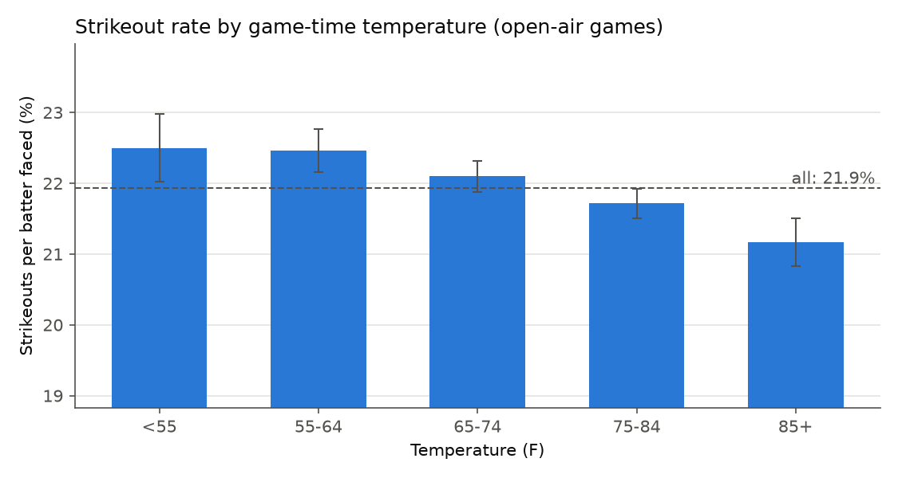

# Strikeout patterns

Starts from seasons 2021-2025 (24,712 starts). Rates are strikeouts per batter faced (K/BF) with 95% intervals; K/start also reflects how deep starters go. These are raw associations: a pattern here can be explained by something else (for example, better pitchers may get more rest), which is why the model, not this table, decides what matters.

## Days of rest

| rest | Starts | K/BF | 95% CI | K/start | BF/start |
|---|---:|---:|---:|---:|---:|
| <=4 | 109 | 23.0% | 20.6-25.4% | 2.50 | 10.85 |
| 5 | 7,783 | 22.1% | 21.9-22.3% | 4.98 | 22.57 |
| 6 | 9,700 | 22.3% | 22.1-22.5% | 5.07 | 22.73 |
| 7-9 | 3,215 | 22.1% | 21.8-22.4% | 4.83 | 21.87 |
| 10-29 | 1,447 | 20.9% | 20.4-21.3% | 3.98 | 19.07 |
| 30+ | 567 | 20.1% | 19.3-20.9% | 3.40 | 16.90 |
| first start | 1,891 | 21.6% | 21.2-22.1% | 3.76 | 17.36 |

## Home vs. away

| where | Starts | K/BF | 95% CI | K/start | BF/start |
|---|---:|---:|---:|---:|---:|
| away | 12,356 | 21.4% | 21.3-21.6% | 4.62 | 21.59 |
| home | 12,356 | 22.7% | 22.5-22.8% | 4.97 | 21.93 |

## Day vs. night

| time | Starts | K/BF | 95% CI | K/start | BF/start |
|---|---:|---:|---:|---:|---:|
| day | 9,266 | 22.4% | 22.2-22.6% | 4.83 | 21.55 |
| night | 15,446 | 21.8% | 21.7-22.0% | 4.78 | 21.88 |

## Platoon: pitcher hand vs. batter side

| matchup | PA | K/PA |
|---|---:|---:|
| RHP vs LHB | 313,646 | 22.1% |
| RHP vs RHB | 359,749 | 23.2% |
| LHP vs LHB | 72,054 | 24.0% |
| LHP vs RHB | 183,657 | 22.0% |

### Starts by share of the lineup with the platoon advantage

| bin | Starts | K/BF | 95% CI | K/start | BF/start |
|---|---:|---:|---:|---:|---:|
| Q1: -0.001 to 0.437 | 5,103 | 22.0% | 21.8-22.2% | 4.77 | 21.66 |
| Q2: 0.437 to 0.545 | 4,934 | 22.2% | 21.9-22.4% | 4.79 | 21.62 |
| Q3: 0.545 to 0.654 | 4,827 | 22.1% | 21.8-22.3% | 4.79 | 21.71 |
| Q4: 0.654 to 0.775 | 5,228 | 21.8% | 21.5-22.0% | 4.74 | 21.75 |
| Q5: 0.775 to 1.000 | 4,620 | 22.2% | 21.9-22.4% | 4.90 | 22.08 |

### Starts by the opposing lineup's prior K rate vs. this pitcher's hand

| bin | Starts | K/BF | 95% CI | K/start | BF/start |
|---|---:|---:|---:|---:|---:|
| Q1: 0.166 to 0.210 | 4,938 | 19.3% | 19.1-19.6% | 4.24 | 21.93 |
| Q2: 0.210 to 0.221 | 4,937 | 21.1% | 20.9-21.4% | 4.59 | 21.73 |
| Q3: 0.221 to 0.230 | 4,937 | 22.0% | 21.7-22.2% | 4.78 | 21.77 |
| Q4: 0.230 to 0.240 | 4,937 | 23.0% | 22.7-23.2% | 4.99 | 21.70 |
| Q5: 0.240 to 0.281 | 4,937 | 24.8% | 24.6-25.1% | 5.38 | 21.67 |

## Pitch type and velocity

| pitch | Pitches | Usage | Swing rate | Whiffs/swing |
|---|---:|---:|---:|---:|
| Fastball < 93 mph | 845,471 | 23.4% | 46.3% | 18.6% |
| Fastball 93-95.9 | 794,374 | 22.0% | 48.1% | 20.2% |
| Fastball 96+ | 385,695 | 10.7% | 51.0% | 23.5% |
| Breaking ball | 1,105,016 | 30.6% | 46.1% | 33.2% |
| Offspeed | 480,098 | 13.3% | 50.9% | 31.4% |

## Which lineups strike out on which pitches (2025)

Each cell is the team's whiffs per swing on that pitch class minus the league rate, in percentage points. Teams are sorted by their average across classes.

Most whiff-prone lineup per class: Fastball < 93 mph: LAA; Fastball 93-95.9: TB; Fastball 96+: SEA; Breaking ball: COL; Offspeed: ATH.

## Weather

### Temperature (open-air games)

| temp | Starts | K/BF | 95% CI | K/start | BF/start |
|---|---:|---:|---:|---:|---:|
| <55 | 1,356 | 22.5% | 22.0-23.0% | 4.85 | 21.54 |
| 55-64 | 3,308 | 22.5% | 22.2-22.8% | 4.89 | 21.75 |
| 65-74 | 6,350 | 22.1% | 21.9-22.3% | 4.80 | 21.74 |
| 75-84 | 6,792 | 21.7% | 21.5-21.9% | 4.74 | 21.81 |
| 85+ | 2,560 | 21.2% | 20.8-21.5% | 4.63 | 21.86 |

### Wind and roof

| wind | Starts | K/BF | 95% CI | K/start | BF/start |
|---|---:|---:|---:|---:|---:|
| calm or cross | 13,754 | 21.9% | 21.8-22.1% | 4.79 | 21.82 |
| in 8+ mph | 2,102 | 22.0% | 21.7-22.4% | 4.77 | 21.63 |
| out 8+ mph | 4,510 | 21.9% | 21.6-22.2% | 4.74 | 21.65 |
| roof closed | 4,346 | 22.5% | 22.2-22.8% | 4.89 | 21.73 |

## Park: highest and lowest strikeout rates

All batters, both teams; minimum 5,000 PA. League K/PA 22.7%.

| park | PA | K/PA | x league |
|---|---:|---:|---:|
| T-Mobile Park | 30,486 | 25.4% | 1.12 |
| Tropicana Field | 24,211 | 24.9% | 1.10 |
| American Family Field | 31,196 | 24.8% | 1.09 |
| Truist Park | 31,142 | 24.6% | 1.08 |
| Yankee Stadium | 31,507 | 23.9% | 1.06 |
| Kauffman Stadium | 30,659 | 19.8% | 0.87 |
| Coors Field | 31,449 | 20.0% | 0.88 |
| Busch Stadium | 30,249 | 20.2% | 0.89 |
| Nationals Park | 30,484 | 20.2% | 0.89 |
| Chase Field | 31,471 | 20.9% | 0.92 |

## Home plate umpire: highest and lowest strikeout rates

All batters, both teams; minimum 3,000 PA. League K/PA 22.7%.

| hp_umpire_name | PA | K/PA | x league |
|---|---:|---:|---:|
| Mike Estabrook | 10,098 | 24.0% | 1.06 |
| Doug Eddings | 11,876 | 24.0% | 1.06 |
| Bill Miller | 11,992 | 23.8% | 1.05 |
| Ron Kulpa | 7,295 | 23.8% | 1.05 |
| Ryan Blakney | 11,110 | 23.8% | 1.05 |
| Scott Barry | 8,768 | 21.3% | 0.94 |
| Clint Vondrak | 9,281 | 21.5% | 0.95 |
| Todd Tichenor | 10,907 | 21.5% | 0.95 |
| Ben May | 11,618 | 21.5% | 0.95 |
| Shane Livensparger | 9,407 | 21.6% | 0.95 |

## Opponent recent form (team K rate over its last 10 games)

| bin | Starts | K/BF | 95% CI | K/start | BF/start |
|---|---:|---:|---:|---:|---:|
| Q1: 0.114 to 0.198 | 4,916 | 20.1% | 19.8-20.3% | 4.40 | 21.95 |
| Q2: 0.198 to 0.217 | 4,911 | 21.2% | 20.9-21.4% | 4.61 | 21.76 |
| Q3: 0.217 to 0.235 | 4,915 | 22.0% | 21.7-22.2% | 4.81 | 21.90 |
| Q4: 0.235 to 0.255 | 4,914 | 23.0% | 22.8-23.3% | 4.97 | 21.61 |
| Q5: 0.255 to 0.391 | 4,904 | 23.9% | 23.7-24.2% | 5.17 | 21.61 |

## Every model feature: rank correlation with strikeouts

Spearman correlation with K in the start and with K/BF. Workload features correlate with K but not K/BF; skill and matchup features correlate with both.

| feature | Starts | rho with K | rho with K/BF |
|---|---:|---:|---:|
| k_per_start_ewm | 23,862 | 0.384 | 0.295 |
| season_k_per_start | 24,686 | 0.352 | 0.273 |
| k_rate_ewm | 23,862 | 0.318 | 0.311 |
| pitcher_k_rate_vs_lineup | 24,686 | 0.310 | 0.317 |
| season_k_rate | 24,686 | 0.280 | 0.284 |
| k_per_bf_last5 | 23,862 | 0.277 | 0.273 |
| pitches_last5 | 23,862 | 0.265 | 0.131 |
| whiff_rate_last5 | 23,862 | 0.246 | 0.255 |
| whiff_rate_last3 | 23,862 | 0.221 | 0.229 |
| matchup_whiff_rate | 23,862 | 0.205 | 0.217 |
| fb_velo_last3 | 23,859 | 0.205 | 0.211 |
| fb_velo_last5 | 23,860 | 0.204 | 0.210 |
| bf_last5 | 23,862 | 0.196 | 0.053 |
| usage_fb_hi_last5 | 23,862 | 0.192 | 0.192 |
| n_prior_starts | 24,712 | 0.160 | 0.046 |
| lineup_k_rate_vs_hand | 24,686 | 0.154 | 0.172 |
| lineup_whiff_os | 24,686 | 0.136 | 0.147 |
| lineup_whiff_brk | 24,686 | 0.134 | 0.147 |
| opp_k_rate_last30 | 24,560 | 0.132 | 0.145 |
| first_start_of_season | 24,712 | -0.120 | -0.008 |
| lineup_whiff_fb_hi | 24,686 | 0.116 | 0.129 |
| park_k_factor | 24,686 | 0.102 | 0.122 |
| rest_days | 23,862 | -0.087 | -0.011 |
| is_home | 24,712 | 0.066 | 0.060 |
| usage_brk_last5 | 23,862 | 0.052 | 0.061 |
| usage_os_last5 | 23,862 | -0.028 | -0.046 |
| roof_closed | 24,712 | 0.019 | 0.024 |
| ump_k_factor | 24,686 | 0.013 | 0.016 |
| lineup_platoon_adv_share | 24,712 | 0.012 | -0.003 |
| is_lhp | 24,712 | -0.012 | -0.005 |
| day_game | 24,712 | 0.007 | 0.021 |
| wind_out_mph | 24,712 | -0.002 | -0.002 |

