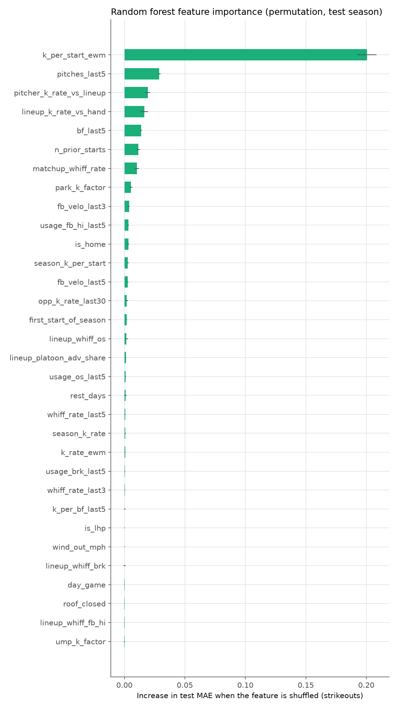
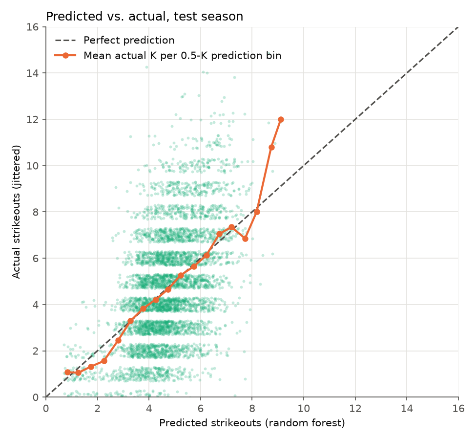
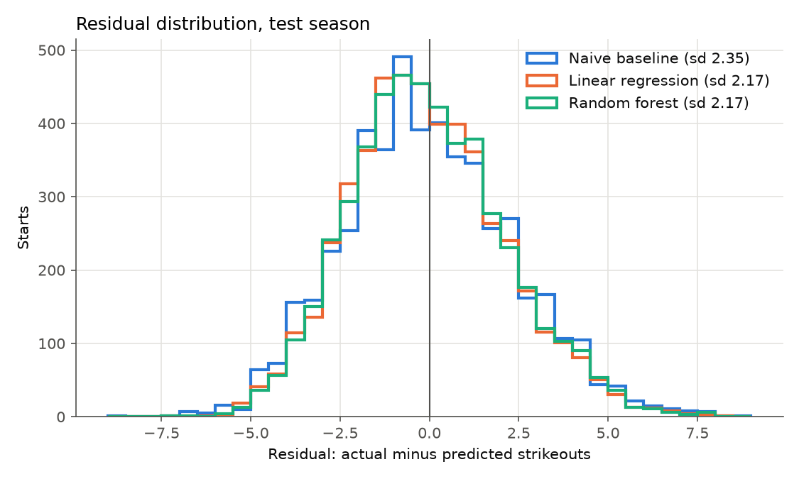

# Results

Train seasons 2021-2025 (24,712 starts), test season 2026 (4,928 starts), data through 2026-10-19. Random forest params: `{'max_depth': 10, 'min_samples_leaf': 10, 'n_estimators': 400}`.

| Model | MAE | RMSE | R² | MAE vs baseline (%) | RMSE vs baseline (%) |
|---|---:|---:|---:|---:|---:|
| Naive baseline | 1.877 | 2.350 | 0.114 | +0.0 | +0.0 |
| Linear regression | 1.736 | 2.171 | 0.244 | +7.5 | +7.6 |
| Random forest | 1.734 | 2.170 | 0.245 | +7.6 | +7.7 |

## Interpretation

The random forest is the best model: test MAE 1.73 strikeouts vs. 1.88 for the naive baseline (7.6% better), RMSE 2.17 vs. 2.35, and R² 0.245 vs. 0.114.

Most of the single-game variance is not predictable before first pitch. Strikeouts in the test season have variance 6.24. Plate-appearance coin-flip noise alone accounts for about 3.63 of it (58%), even for a model that knew each pitcher's true K rate and exactly how many batters they would face, which caps R² near 0.42. The random forest reaches R² 0.245, about 58% of the variance that is explainable in principle.

The remaining error comes mostly from things no pre-game feature sees: how long the manager leaves the starter in (an early hook or a pitch-count limit removes batters faced, the biggest driver of the count), the home-plate umpire's zone, in-game injuries and blowouts, and plate-appearance-level randomness in matchups. Batters faced varies a lot from start to start and the model can only guess it from recent workload.

The most useful features on the test season were k_per_start_ewm, pitches_last5, pitcher_k_rate_vs_lineup (permutation importance).

Leakage sanity check: adding the current game's batters faced drops random forest MAE to 1.62 (7% lower) and lifts R² to 0.33, and the leakage audit flags it. The honest features pass the same audit.

## What each feature group adds

| Feature set | Features | Linear MAE | RF MAE | RF R² |
|---|---:|---:|---:|---:|
| core | 16 | 1.762 | 1.754 | 0.228 |
| core + matchup | 27 | 1.740 | 1.737 | 0.243 |
| core + context | 21 | 1.757 | 1.752 | 0.229 |
| all | 32 | 1.736 | 1.734 | 0.245 |

Core = pitcher form, workload, rest, home/away, opponent K rate. Matchup = lineup handedness and K rates, pitcher platoon splits, pitch mix vs. lineup whiff rates. Context = weather, day/night, park and umpire factors, opponent last-10 form.

## Leakage audit

- Real feature set: **passed**
- With current-game batters faced added: **caught**

## Figures

